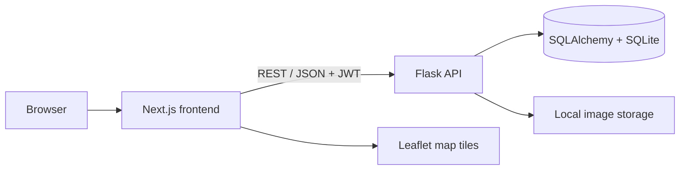

# Project overview

## Problem

People often receive traffic incident information late or through fragmented channels. A centralized, geospatial view can make reports easier to find and compare.

## Solution

The Traffic Accident Management System lets authenticated users submit an incident with geographical coordinates and contextual details. Flask REST endpoints store reports in a relational database, while a separate Next.js frontend displays them on a Leaflet map and heatmap. A simple verification workflow gives officers a way to review reports, while administrators manage accounts and approvals.

## Architecture

## Individual contributions

- Designed and implemented the Flask backend, REST endpoints, database models, and role-based authentication.
- Implemented the separate frontend with map interactions, reporting forms, and administrative screens.
- Connected the API and user interface, including geospatial visualization and incident verification workflows.
- Added gamification elements such as points, comments, and leaderboard features.

## Demonstrable skills

Python, Flask, TypeScript, React, Next.js, REST API design, SQLAlchemy, SQLite, JWT, maps / geospatial visualization, user roles and permissions, GitHub documentation, and Docker.

## Future improvements

- Persist revoked tokens and strengthen browser session handling.
- Add database migrations and deployment-grade image storage.
- Add full integration tests and CI, including frontend builds and browser end-to-end scenarios.
- Add appropriate rate limiting, abuse moderation, and production monitoring.
